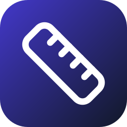

# FitChart: size chart pop-up for Wix Stores, by Coders Creation



A self-hosted Wix App Market app for fashion, shoe and sports stores. It adds a **"Size guide"** link next to the size
option on Wix Stores product pages. The link opens a size chart chosen for that product or category. It has three parts:

1. **Visitor script** (`public/guide.js`, ~24 KB, no dependencies). Wix injects it on every page as an embedded script.
2. **Settings page**, shown inside the Wix dashboard in an iframe. It has a chart editor, templates, assignments, a live preview and shopper numbers.
3. **Backend** (Node 22 + Express + SQLite). It handles Wix auth, webhooks and billing, product lookups and image uploads, and serves the chart for each product.

The Wix code (signed instance, webhooks, embedding the script, plan sync) is the same code used by LumAccess and AdBlock Notice,
so all three apps install, bill and deploy the same way.

Demo video: `docs/media/fitchart-demo.mp4` (65 s). App Market screenshots and the icon are also in `docs/media/`.
The listing copy is in [`docs/app-market-listing.md`](docs/app-market-listing.md), and the YouTube title and description are in [`docs/youtube.md`](docs/youtube.md).

> **Name:** "FitChart" is a working name. Before you publish, search the Wix App Market and the trademark registers for it. `APP_NAME` in `.env` changes the name everywhere.

---

## Features

| Area | What it does | Plan |
|---|---|---|
| **Size guide link** | A text link or button with a ruler icon. It goes under the size option (detected in 20+ languages: Size, Größe, Taille, Talla, Taglia, Maat, Storlek…), above "Add to Cart" or under the product name. A custom CSS selector is available for unusual themes. If no spot is found, a "Size guide" tab shows on the side of the page (optional). | Free |
| **Pop-up** | A centered pop-up or a side panel; on phones it opens as a bottom sheet. It has a sticky table header, a first column for row labels, a "how to measure" note and "Powered by". Accent, text, background and header colors are adjustable. | Free |
| **Templates** | Women's, men's, shoes (EU/UK/US + foot length), gloves (hand circumference), boxing gloves (by body weight), kids, pants & jeans | Free |
| **Table editor** | Edit cells inline, add and remove rows (up to 40) and columns (up to 12), and paste straight from Excel or Google Sheets. Column types (text, length or weight) are detected from the header. | Free |
| **Unit switch** | Shoppers toggle cm ↔ inches and kg ↔ lb. Ranges like `86-90` convert as a whole (`34-35.5`), and text columns such as EU/US sizes stay as they are. The shopper's choice is remembered. | Pro |
| **Several charts** | One chart per product type. Each chart can apply to specific products, keywords in the product name or URL (`glove`, `shoe`), store **categories/collections**, or "all other products". The most specific match wins. | Free: 1 chart, Pro: 50 |
| **Images** | A "how to measure" picture under each chart. Upload a PNG, JPG, WebP or GIF (up to 2 MB, checked by its file signature; SVG is refused) or paste an image URL (for example from Wix Media). | Pro |
| **Branding** | Hide the "Powered by" line | Pro |
| **Shopper numbers** | Visits that saw the link, visits that opened the guide, open rate, unit switches, and a daily chart. Each event counts once per visit. | 7 days Free, 90 days Pro |
| **Preview on my site** | The dashboard links to `https://<site>/?sg-preview=1&sg-open=1`, which opens the first chart on any page | Free |

Behind the scenes:

- **Wix is a single-page app.** When shoppers move between products the URL changes without a reload, and Wix re-renders the
  product block. The script watches the URL and the page, fetches the right chart, and puts the link back whenever Wix
  removes it.
- **Categories** come from the Wix Stores API (Catalog V1 collections, or V3 categories on newer stores). The server looks up
  a product by its URL slug only when a chart uses categories, and caches the answer for 6 hours. Keyword and product rules
  need no API call at all.
- **Plans are enforced on the server.** After a downgrade, Free sites get only chart 1, with no image and no unit switch. The
  other charts stay saved and come back on upgrade.
- **Accessibility:** the link is a real `<button>` with `aria-haspopup`. The pop-up is a labelled `role="dialog"` with a focus
  trap, Escape and backdrop close it, focus returns to the link, the unit toggle uses `aria-pressed`, the table has
  `scope` headers and a caption, and animations respect `prefers-reduced-motion`.
- **No clash with the theme:** the link and pop-up are drawn in closed shadow roots, so Wix theme CSS can't break them and
  they can't break the theme.

---

## Layout

- `public/guide.js` holds the visitor script: finding the product page, placing the link, the pop-up and unit conversion. Without `data-instance` it only exposes `window.SizeGuide` (`open`, `trigger`, `convert`, `productSlug`), which the dashboard preview and the tests use.
- `public/dashboard/` is the settings page (plain HTML/CSS/JS).
- `public/demo.html` is a fake Wix Stores product page, served at `/demo` and `/product-page/<slug>` in `DEV_MODE` only.
- `src/plans.js` holds the plans, default settings, chart validation, plan enforcement and chart matching. `src/templates.js` holds the templates.
- `src/routes/public.js` is what the visitor script calls (`/api/v1/guide`, `/api/v1/ping`), `src/routes/dashboard.js` is the settings API (including `/images`) and `src/routes/webhooks.js` receives Wix events.
- `src/wix.js` and `src/sites.js` handle Wix auth, the embed call, plan sync and the Stores product and category lookups.

---

## Run locally

```bash
cd wix-size-chart
npm install
npm test          # 6 integration tests
npm run dev       # DEV_MODE=1 on http://localhost:8080
```

- Test store: http://localhost:8080/demo. The links at the top switch products without a reload, like a Wix site.
- Settings page without Wix: http://localhost:8080/dashboard?instanceId=dev-site-0001&plan=pro (drop `&plan=pro` to see Free)

Charts are cached in the browser for 5 minutes, so open a new private window to see a change straight away.
`DEV_MODE` accepts unsigned dashboard requests. **Never enable it in production.**

---

## Deploy on CloudPanel (Node.js site + PM2)

The same steps as the other Coders Creation apps. Use a hostname such as `sizes.coderscreation.com`.

1. **DNS:** add an A record `sizes` → your VPS IP.
2. **Create the site:** CloudPanel → **Add Site → Create a Node.js Site**. Domain `sizes.coderscreation.com`, **Node.js 22**,
   App Port `8082` (any free port; the other apps may already use 8080/8081), and a site user such as `fitchart`.
3. **HTTPS:** **SSL/TLS → Actions → New Let's Encrypt Certificate**.
4. **Upload the code** as the site user:
   ```bash
   cd ~/htdocs/sizes.coderscreation.com
   git clone <this repo> repo && cp -r repo/wix-size-chart/. . && rm -rf repo
   node -v                      # must be 22.13 or newer (node:sqlite)
   npm ci --omit=dev
   cp .env.example .env         # BASE_URL=https://sizes.coderscreation.com, PORT=8082, Wix keys (below)
   ```
5. **Start it with PM2:**
   ```bash
   npm install -g pm2           # skip if pm2 -v already works
   pm2 start ecosystem.config.cjs && pm2 save
   crontab -e                   # add: @reboot cd ~/htdocs/sizes.coderscreation.com && pm2 resurrect
   curl https://sizes.coderscreation.com/healthz   # {"ok":true}
   ```
   Keep one instance: SQLite and the rate limiter expect a single process.
6. **Updates:** pull the new code into the folder, then `npm ci --omit=dev && pm2 restart fitchart`.
7. **Backups:** the data is `data/app.db` plus the images in `data/uploads/`. Add a cron job:
   `15 3 * * * cd ~/htdocs/sizes.coderscreation.com && node scripts/backup.mjs` (database, 14 days), and copy `data/uploads/`
   off the server with your usual backup tool.

**Docker instead:** `DOMAIN=sizes.example.com docker compose -f deploy/docker-compose.yml up -d --build` (Caddy gets the
certificate). If LumAccess already runs Caddy on the same VPS, add a `sizes.example.com { reverse_proxy … }` block to that
Caddyfile instead of starting a second Caddy.

---

## Wix Dev Center setup (step by step)

1. **dev.wix.com → Create New App**, then choose a self-hosted app on your own server.
2. **OAuth**: copy the **App ID** and **App Secret** into `WIX_APP_ID` and `WIX_APP_SECRET`.
3. **Permissions**: add the scopes for the App Instance API and the Embedded Scripts API ("Manage Embedded Scripts"),
   plus **read access to Wix Stores products and collections/categories** ("Read Products" / "Read Stores catalog",
   and "Read Categories" for stores on Catalog V3). Without the Stores scopes, everything works except category rules.
4. **Extensions → Embedded Script**:
   - Type *Functional*, placement *Body end*, load once on all pages.
   - HTML: `<script src="https://sizes.coderscreation.com/guide.js" data-instance="{{instanceId}}" defer></script>`
   - Declare the dynamic parameter `instanceId`. The server activates the script at install (`POST /apps/v1/scripts`).
5. **Extensions → Dashboard Page**: iframe URL `https://sizes.coderscreation.com/dashboard`. Wix appends `?instance=<signed>`.
6. **Webhooks**: callback `https://sizes.coderscreation.com/webhooks/wix`. Subscribe to *App Installed*, *App Removed*,
   *Paid Plan Purchased*, *Paid Plan Changed*, *Paid Plan Auto Renewal Cancelled*, *Plan Converted To Paid*,
   *Plan Reactivated* and *Plan Transferred*. Copy the **public key** into `WIX_PUBLIC_KEY`.
7. **Pricing**: create Free and Pro plans (suggested prices are in the listing doc), then map the Pro IDs:
   `WIX_PLAN_MAP={"<pro-monthly-id>":"pro","<pro-yearly-id>":"pro"}`.
8. **Test** on a Premium Wix site with a connected domain and Wix Stores. Add a product with a "Size" option, publish, and
   check that the link appears. Then try a category rule, the inch switch (buy Pro with Wix test billing) and an image upload.
9. **App Market listing**: paste the text from `docs/app-market-listing.md`, upload the screenshots and icon from
   `docs/media/`, add the YouTube link of the demo video, the privacy policy URL and the support email, then submit.

Wix renames Dev Center menus from time to time. If a label differs, look for the matching setting. The API endpoints above are the ones the code calls.

---

## Privacy

The visitor script sets no cookies. It uses `localStorage` for the shopper's unit choice and `sessionStorage` to count each
event once per visit. The server stores per-site, per-day totals (no IPs, no visitor IDs), the owner's charts and
uploaded images, and a cache of product slug → name and category IDs. The web server's access log (Nginx or Caddy)
records IPs, as it does for any site.
